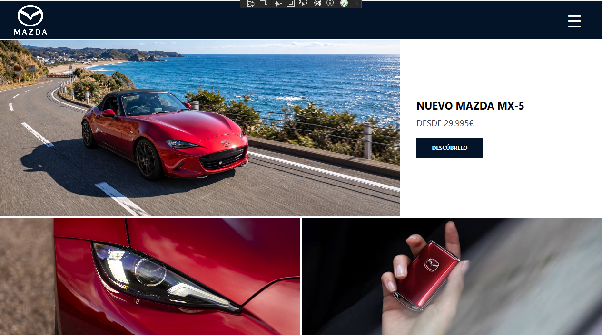

# Mazda · Prototipo de aplicación de escritorio (WPF)

Hola 👋 Este es mi trabajo de la **Práctica 1** de *Interfaces de Usuario*
(Grado en Ingeniería Informática en Tecnologías de la Información, UMH).

La idea era diseñar el prototipo de una aplicación de escritorio para una
tienda de coches, siguiendo unos requisitos de cliente, y hacerlo con
**Microsoft Blend / WPF**. Yo lo planteé como la app de una tienda de Mazda,
con el MX-5 como modelo destacado.

> ⚠️ Es un **prototipo**: no hay base de datos ni servidor. Lo importante aquí
> era la interfaz, la usabilidad y la navegación.



## Qué hace la aplicación

- **Inicio**: portada con el modelo destacado (MX-5), su precio y un botón
  para descubrirlo.
- **Login / Sign up**: formulario con pestañas animadas. La contraseña se
  oculta, hay un texto de ayuda (placeholder) y avisos de error si falta algo
  o si los datos no son correctos.
- **Galería**: seis modelos de la gama en tarjetas (MX-5, CX-5, Mazda6,
  Mazda3, CX-30 y CX-60).
- **Ficha del MX-5**: descripción, potencia, 0-100 km/h, tracción y un botón
  de "Solicitar prueba".
- **Elementos comunes** en todas las pantallas: la barra superior con el
  **logotipo** y el **menú lateral** desplegable (Inicio, Login, Galería, Salir).

## Cómo probarlo

1. Necesitas Windows y **Visual Studio 2022** (o Blend) con la carga de trabajo
   de *desarrollo de escritorio de .NET*.
2. Clona el repositorio:
   ```bash
   git clone https://github.com/[TU_USUARIO]/practica1-prototipo-wpf-mazda.git
   ```
3. Abre el archivo `.csproj` / la solución y pulsa **F5**.

**Usuario de prueba:** `Alumno` · **Contraseña:** `1234`
(está escrito a propósito en el código porque es un prototipo; en una app real
esto iría contra un servidor, nunca en el cliente).

## Cómo está organizado

```
├── MainWindow.xaml        # Toda la interfaz (pantallas y menú)
├── MainWindow.xaml.cs     # Lógica: navegación, login y animaciones
├── img/                   # Imágenes usadas en la app
└── capturas/              # Pantallazos para este README
```

Todas las pantallas viven en una sola ventana (`Inicio`, `Login`, `Galería`,
`MX5`) y se muestran u ocultan con `Visibility`. Así la barra superior y el
menú lateral son siempre los mismos y no se repiten.

## Decisiones de diseño (resumen)

- **Consistencia**: misma barra, mismos colores (azul oscuro `#041428` y
  blanco) y mismos botones en todas las pantallas.
- **Jerarquía visual**: títulos grandes en negrita, datos secundarios en gris.
- **Prevención y gestión de errores**: se avisa si dejas campos vacíos y si el
  usuario o la contraseña no son correctos, y el cursor vuelve al campo de usuario.
- **Feedback**: mensajes al iniciar sesión, al solicitar una prueba y al
  recuperar la contraseña; cursor de mano en lo que se puede pulsar.
- **Animaciones con moderación**: solo dos. El menú lateral se desliza (0,25 s)
  y la línea de las pestañas Login/Sign up se desplaza (0,25 s). Nada más,
  para no distraer.

*(La explicación completa está en la documentación técnica entregada.)*

## Pruebas y mejoras

[Aquí cuenta qué probaste y qué arreglaste. Por ejemplo: probé a entrar con
campos vacíos, con contraseña incorrecta, abrí y cerré el menú varias veces...
y qué cambiaste después.]

## Recursos utilizados

| Recurso | Para qué | Procedencia / licencia |
|---|---|---|
| Imágenes de los modelos (`img/`) | Galería e inicio | [web de donde las sacaste] · Son de Mazda, uso solo educativo |
| Logotipos | Barra y login | [procedencia] |
| Tipografía | Interfaz | Por defecto de WPF (Segoe UI) |
| Plantilla de botón `BotónLateral` | Botones sin efecto hover | Generada con Blend a partir del estilo estándar de WPF |

## Uso de inteligencia artificial

Como pide el enunciado, lo dejo todo documentado:

- **Herramienta y fecha**: [Claude (Anthropic), noviembre de 2026]
- **Para qué la usé**: [por ejemplo: ayuda para subir el proyecto a GitHub
  y redactar este README]
- **Prompts y respuestas**: [enlace a la conversación compartida o carpeta `ia/`
  con los textos]
- **Qué revisé yo**: [qué comprobaste, qué aceptaste, modificaste o descartaste]
- **Mi aportación**: [lo que hiciste tú: diseño, XAML, lógica, pruebas...]

## Enlaces

- Repositorio: [enlace]
- Prototipo / capturas: [enlace]

---
Hecho por [Tu nombre] · UMH · [Curso 2026/27]
